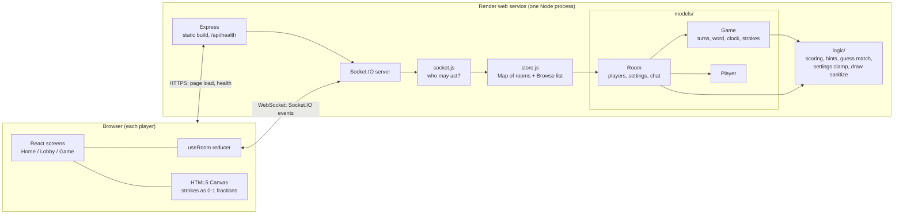
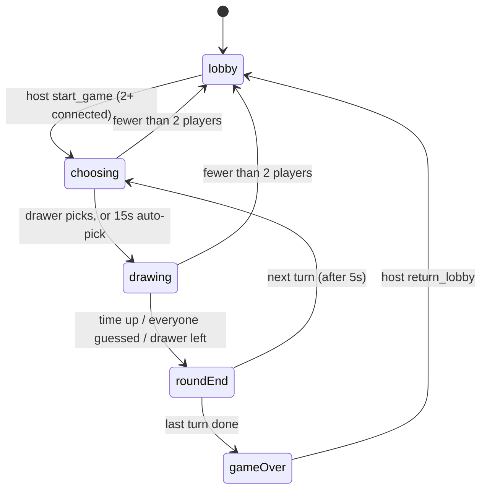
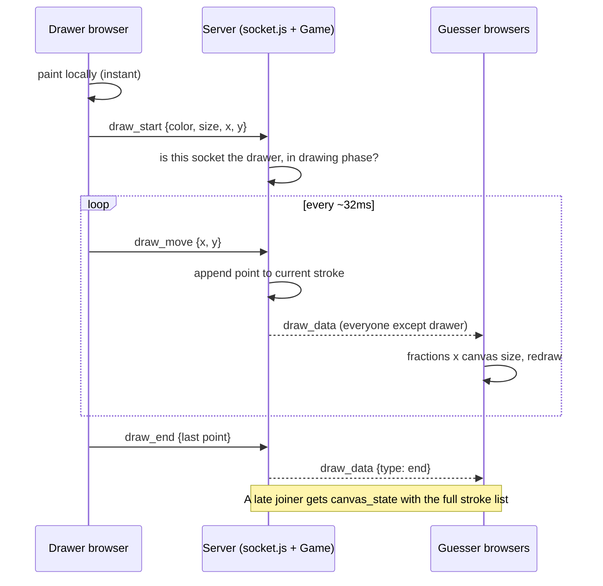
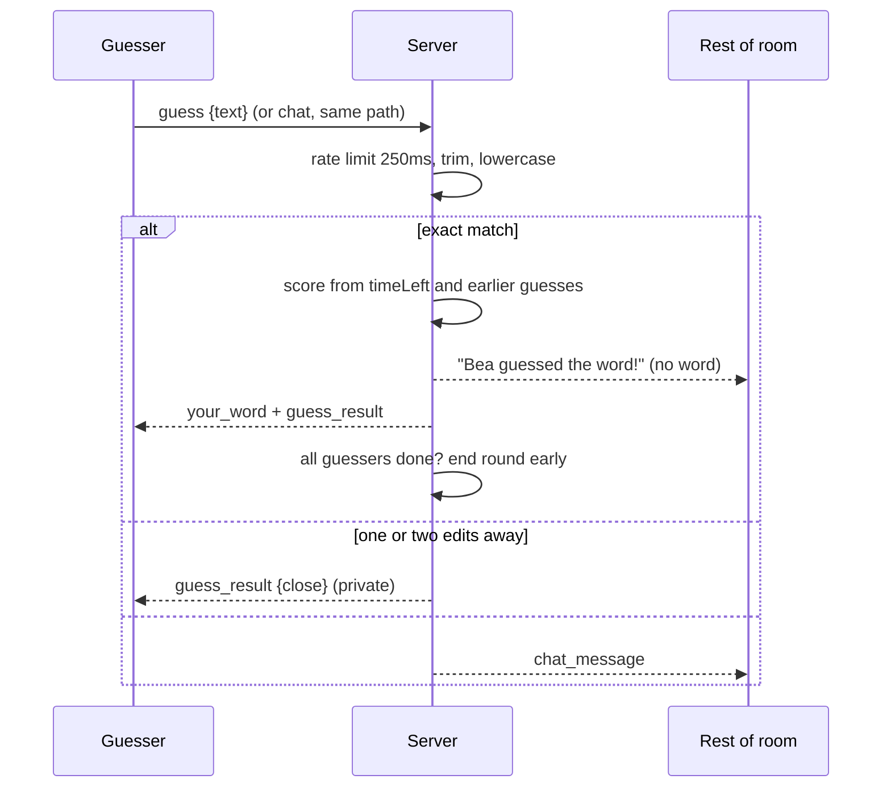
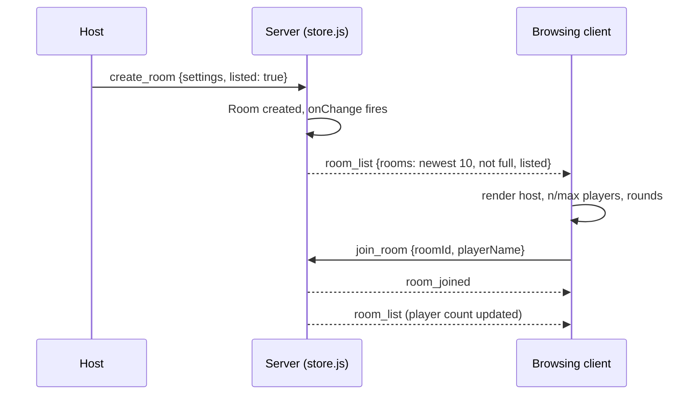

# Skribbl

> **Heads up: Render free tier cold starts.**
> The live demo runs on Render's free plan. After about 15 minutes with no traffic the service spins down. The next visit takes **roughly 30–60 seconds** to wake up, and the page may look blank or stuck on "Rejoining your room…" until it does.
> A spin-down (or any redeploy) also **wipes every room**, because rooms live in server memory. If a game is in progress when that happens, everyone is dropped back to the home screen.
> Open the link a minute before you want to play, and refresh once if the first load hangs.

**Live URL:** _add the `https://<your-service>.onrender.com` URL here after the first deploy._

A multiplayer drawing and guessing game. One player draws a word, everyone else tries to name it, and the highest score after the last round wins. The browser is only a client. The Node server owns the rooms, the word, the clock and the scores.

Reasoning behind each choice: [DESIGN.md](DESIGN.md). Walkthrough-style questions with answers: [QUESTIONS.md](QUESTIONS.md).

## Contents

1. [How the app works](#how-the-app-works)
2. [Architecture](#architecture)
3. [Block diagrams](#block-diagrams)
4. [Socket events](#socket-events)
5. [Run it locally](#run-it-locally)
6. [Deploy to Render](#deploy-to-render)
7. [Limitations](#limitations)
8. [Project layout](#project-layout)

## How the app works

### Home screen

Enter a name, then pick one of three tabs:

- **Create** – choose the settings and get a 6-character room code. The invite link is `/?room=CODE`.
- **Join** – type a code, or open an invite link (it prefills the code).
- **Browse rooms** – a live list of up to 10 open rooms. Each row shows only the **host**, **player count** (`n/max`) and **rounds**, with a **Join** button. The room code is sent to the client so Join works, but it is never shown.

Which rooms appear in Browse:

- Every room is invite-only at creation. By default a room is also *listed*. The host can untick **List in Browse rooms** to keep it code-only.
- Full rooms are skipped, so a dead row never takes up one of the 10 slots.
- The newest 10 listed rooms win.
- The server pushes a fresh list to every connected browser whenever a room is created, joined, left or emptied.

### Lobby

Everyone sees the player list. Every connected non-host player must press **Ready** before the host can start. The host needs no Ready button, because pressing Start is their ready. The server enforces this and names who is still holding things up. A disconnected seat is ignored. The host also needs at least two connected players.

Host settings, clamped again on the server: 2–20 players, 2–10 rounds, 15–240 s draw time, 1–5 word choices, 0–5 hints.

### A game

1. Turn order is shuffled once. A "round" means every player draws once, so total turns are players × rounds.
2. The drawer gets 1–5 words and 15 seconds to pick. If they wait, the server picks one at random. Everyone else only sees that a word is being chosen.
3. The drawer paints. Guessers type in the same box they use for chat. A correct guess is not echoed. The room sees "Alex guessed the word!"
4. The round ends when time runs out or every connected guesser has it. The word is revealed for 5 seconds, then the next drawer goes.
5. After the last turn the leaderboard stays up until the host returns everyone to the lobby. Ties are called as ties.

### Drawing

The canvas stores points as fractions of its width and height (`0–1`), so a phone and a laptop line up. The drawer paints immediately. About every 32 ms the client sends `draw_move`. The server appends the point to the current stroke and relays it to everyone else. The drawer never receives their own stroke back.

The **Eraser** button paints in the board color (white), so it is an ordinary stroke: it is relayed, undone, cleared and replayed for late joiners with no extra event. Picking a color switches back to the pen.

A stroke is `{ color, size, points }`. Undo pops the last stroke, clear empties the list, and both are broadcast. On join or refresh the server sends the whole stroke list so the canvas can be redrawn from scratch. Colors and the three brush sizes are a fixed set that the server enforces. Only the current drawer can draw, and only while the phase is `drawing`.

### Words, hints and scores

Guesses are trimmed, lowercased and collapsed to single spaces before comparison.

- The same word is correct.
- One edit away is "close" (two edits if the word is longer than 6 letters). Only that guesser is told.
- Anything else is ordinary chat.

The real word goes only to the drawer, to a player who already guessed it, and to the whole room once the round is over. Shared updates carry the mask (`_ _ a _ _`). Hints split the draw time into `hints + 1` slices and reveal one random hidden letter at the end of each slice except the last. One letter always stays hidden.

Scoring:

- Guesser: `round(100 + 400 × timeLeft / drawTime) − 25 × earlierCorrectGuesses`, never below 50. A first guess on a full clock scores 500.
- Drawer: 50 points per player who guessed, paid when the round ends. A drawer who leaves gets nothing for that round.

### Reconnects

A dropped socket keeps its seat for 20 seconds. A refresh reclaims the same player, score and, if they were drawing, the paused clock. After 20 seconds the seat is removed and host moves to the next player. If fewer than two players remain mid-game, the room returns to the lobby with no winner.

## Architecture

One Node process serves everything on one port: the built React app, `GET /api/health`, and the Socket.IO endpoint. There is no database and no second service.

| Layer | Technology | Responsibility |
| --- | --- | --- |
| UI | React 18 + Vite | Home, Lobby and Game screens, canvas, chat |
| Client state | One `useRoom` reducer | Turns server events into UI state. Screens never see event names |
| Transport | Socket.IO 4 | Drawing sync, guesses, chat, game state, room list |
| HTTP | Express 4 | Static files, SPA fallback, health check |
| Socket layer | `server/src/socket.js` | Checks *who* may send an event, then calls a model. No game rules here |
| Models | `Room`, `Game`, `Player` | Room owns people, settings and chat. Game owns the turn, word, clock and strokes |
| Logic | `server/src/logic/*` | Pure functions: settings clamp, guess matching, scoring, hints, stroke sanitizing, word picking |
| Store | `server/src/store.js` | A `Map` of rooms plus the Browse list. The process is the database |

Design rules the code follows:

- **The server decides.** Scores, the word, the clock, hints and "is this a guess" never come from the client.
- **The word never rides on shared state.** Word options go only to the drawer's socket.
- **Strokes are the source of truth, not pixels.** Late joiners redraw from the stroke list.
- **Socket ids are not identities.** A player id kept in `sessionStorage` identifies a seat across refreshes.

## Block diagrams

### System overview



### Game phases



### One stroke, drawer to guesser



### A guess



### Browse rooms



## Socket events

Client → server: `create_room`, `join_room`, `leave_room`, `list_rooms`, `player_ready`, `update_settings`, `start_game`, `return_lobby`, `word_chosen`, `draw_start`, `draw_move`, `draw_end`, `draw_undo`, `canvas_clear`, `guess`, `chat`.

Server → clients: `room_joined`, `player_joined`, `player_left`, `room_update`, `room_list`, `game_state`, `round_start`, `timer_tick`, `hint_update`, `your_word`, `draw_data`, `canvas_state`, `guess_result`, `chat_message`, `round_end`, `game_over`, `session_taken`, `error`.

`round_start` carries `wordOptions` only on the drawer's socket. Actions that can fail take an acknowledgement; draw events do not, so a stroke never waits on a round trip.

## Run it locally

Node 18 or newer.

```bash
npm install
npm test
npm run dev
```

Open http://localhost:5000. The Vite dev server proxies `/socket.io` and `/api` to the API on port 3000.

Run the two processes separately:

```bash
npm run dev -w server   # API + sockets on :3000
npm run dev -w client   # Vite on :5000
```

Production build on one process:

```bash
npm install
npm run build
npm start
```

The server listens on `PORT` (default 3000), serves `client/dist`, and hosts Socket.IO on the same port. `GET /api/health` returns `{ "ok": true }`.

If you change server code and the UI behaves as if nothing happened, restart the server. A stale process silently ignores events it does not know, such as `list_rooms`.

## Deploy to Render

The repo ships a Blueprint, [`render.yaml`](render.yaml).

1. Push the repo to GitHub.
2. In Render choose **New → Blueprint** and select the repo. Render reads `render.yaml` and creates one web service.
3. Wait for the build, open the `onrender.com` URL, and paste it at the top of this README.

What the Blueprint sets:

- Build: `npm install --include=dev && npm run build`. The `--include=dev` matters because Vite is a devDependency and Render builds with `NODE_ENV=production`.
- Start: `npm start`. Health check: `/api/health`.
- `numInstances: 1` on purpose. See limitations.
- `PORT` is injected by Render and read by `server/src/index.js`. `CLIENT_ORIGIN` is not needed because the UI and the API share one origin.

WebSockets work on Render web services without extra configuration. This is why the client is served by the Node process instead of Vercel or Netlify, which cannot hold a long-lived socket.

## Limitations

**Hosting (Render free plan)**

- **Cold start.** The service sleeps after about 15 minutes idle and takes roughly 30–60 seconds to wake. The first player to arrive pays for it.
- **Spin-down erases rooms.** Rooms are in memory. Sleeping, crashing or redeploying drops everyone, and invite links to those rooms stop working.
- **Single instance only.** Rooms are not shared between processes. Scaling to two instances would split players across rooms that cannot see each other. Fixing this means Redis (or similar) plus the Socket.IO Redis adapter, with rooms serialized on every change.
- **Limited CPU and bandwidth.** Fine for a few small rooms. Many rooms drawing at once will lag.

**Product**

- **No accounts.** A player is a seat id in this tab's `sessionStorage`. Closing the tab for more than 20 seconds gives up the seat.
- **Listed rooms are discoverable by anyone.** A room is listed by default and shows its host's name. There is no moderation, kick, ban or report, so a stranger can join a listed room and misbehave. Untick "List in Browse rooms" for anything you want private.
- **One idle player can hold the lobby.** Start waits for every connected non-host player to be ready, and the host cannot override it. The only ways out are for that player to press Ready, leave, or drop off for 20 seconds.
- **Browse list is capped and unpaged.** Only the newest 10 open rooms show. Older rooms are still joinable by code.
- **In-progress games stay listed** while they have space. Late joiners can enter mid-round.
- **Room list is broadcast to every connected socket,** including players already in a game. Fine at this scale. A dedicated "browsing" socket room would be the next step.
- **The eraser is a white stroke, not a true erase.** It relies on the board being opaque white and adds a stroke instead of removing pixels. It undoes and replays like any stroke.
- **No word categories, custom words, word modes, spectators, avatars or replay.**
- **One word list in English,** about 360 words.
- **Guess matching is strict about punctuation.** `cat!` is not `cat`. No plurals or spell-check beyond a 1–2 edit "close".
- **Canvas has no pressure, zoom or fill tool.** Three brush sizes, twelve colors.

**Engineering**

- Tests cover guess matching, scoring and the Browse list. The socket flow and the UI were checked by hand, not by an automated browser test.
- No rate limit on `create_room` or `join_room`, so one client can create many rooms. Only text is throttled.
- There is no auth or abuse protection beyond input clamping and the text rate limit.

## Project layout

```
render.yaml          Render Blueprint
client/              React + Vite
  src/screens/       Home, Lobby, Game
  src/hooks/useRoom.js   the only place that talks to the socket
  src/components/    Canvas, Toolbar, Chat, PlayerList, SettingsForm, ...
server/              Express + Socket.IO
  src/index.js       HTTP server, static files, health check
  src/socket.js      event guards, join/reclaim logic
  src/store.js       rooms Map, Browse list
  src/models/        Player.js, Room.js, Game.js
  src/logic/         settings, words, matchGuess, hints, scoring, draw
  test/              node:test suites
```
